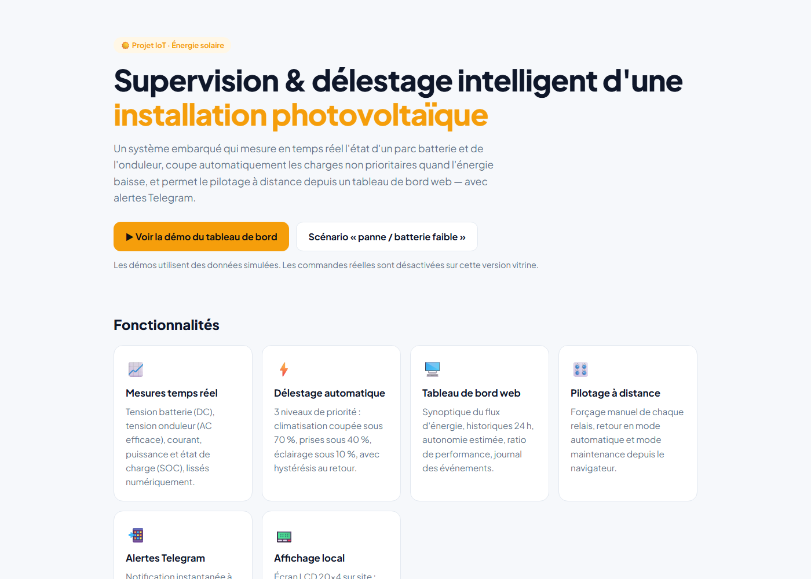
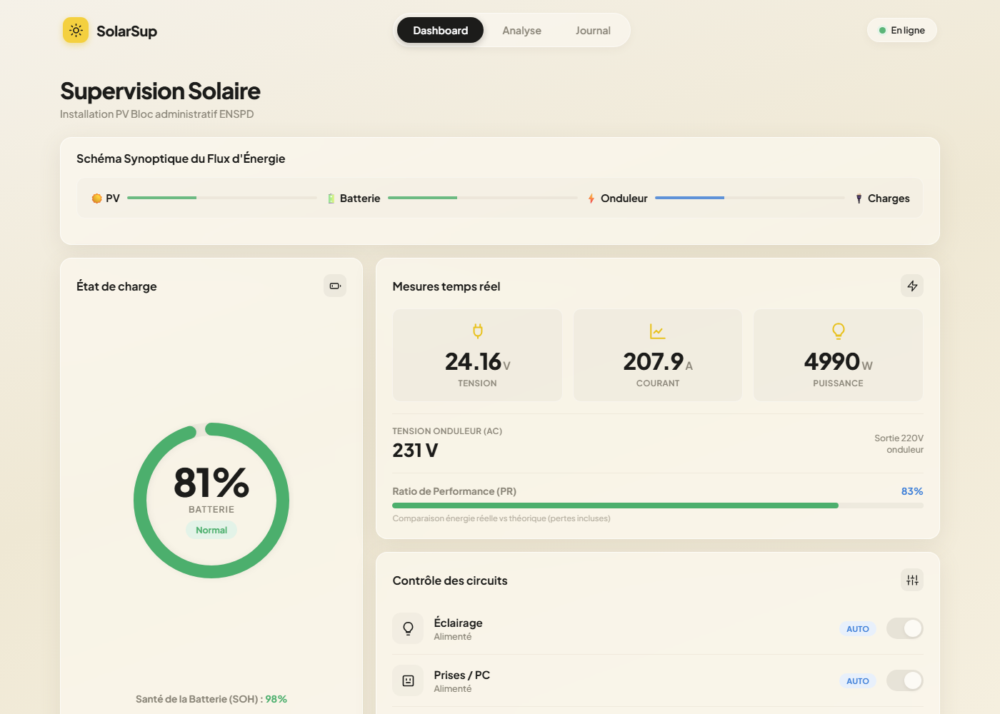
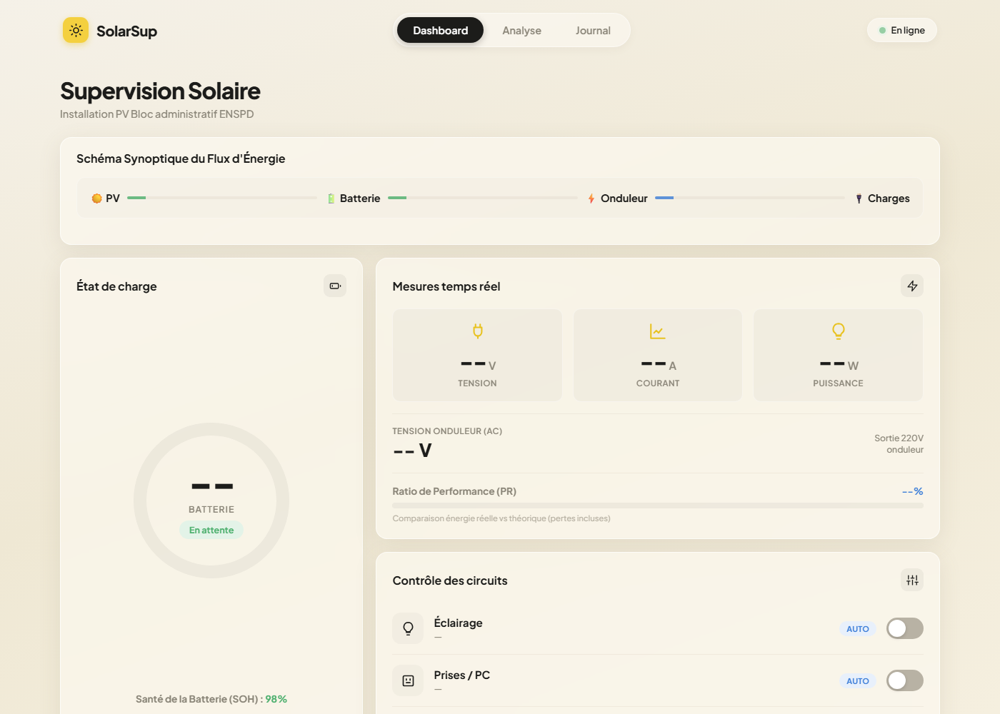

# ☀️ Supervision Solaire — Délestage intelligent d'une installation photovoltaïque

> Système IoT de supervision en temps réel d'une installation solaire (batterie + onduleur), avec délestage automatique des charges, tableau de bord web et alertes Telegram.
> Projet réalisé pour l'installation PV du bloc administratif de l'ENSPD.

### 🔗 [Voir la démo en ligne](https://supervision-solaire-enspd.vercel.app)

*Version vitrine : les tableaux de bord affichent des données simulées, les commandes matérielles sont désactivées.*

> ℹ️ Ce dépôt est une **vitrine** : le code source est conservé dans un dépôt privé. Disponible sur demande pour les clients.

---

## 📸 Captures d'écran

| Page d'accueil | Tableau de bord |
|---|---|
|  |  |

**Scénario « panne / batterie faible » — délestage en action**



---

## ✨ Fonctionnalités

- **📈 Mesures en temps réel** : tension batterie (DC), tension de sortie onduleur (AC efficace), courant (capteur ACS712), puissance et état de charge (SOC), avec lissage numérique des mesures.
- **⚡ Délestage automatique à 3 niveaux** : les charges sont coupées par ordre de priorité quand la batterie se décharge, puis réarmées automatiquement.

  | Circuit | Priorité | Coupure | Réarmement |
  |---|---|---|---|
  | Climatisation | Basse | SOC ≤ 70 % | SOC > 70 % |
  | Prises / PC | Moyenne | SOC ≤ 40 % | SOC > 40 % |
  | Éclairage | Haute | SOC ≤ 10 % | SOC > 10 % |

- **🖥️ Tableau de bord web** hébergé directement sur l'ESP32 : synoptique animé du flux d'énergie (PV → batterie → onduleur → charges), historiques 24 h (SOC et puissance), autonomie estimée, énergie consommée du jour, ratio de performance, temps d'indisponibilité, journal des événements.
- **🎛️ Pilotage à distance** : forçage manuel de chaque relais, retour en mode automatique, mode maintenance.
- **📲 Alertes Telegram** instantanées à chaque franchissement de seuil critique.
- **📟 Affichage local** sur écran LCD 20×4 (SOC, courant, tensions, état des circuits).

## 🏗️ Architecture

```
 Capteurs (tension DC, tension AC, courant ACS712)
                    │
                    ▼
   Arduino ── relais (3 circuits) + écran LCD I²C
                    │  liaison série UART (trames <SOC;Vbat;Vac;R1;R2;R3;I>)
                    ▼
   ESP32 ── Wi-Fi ── serveur web embarqué + API JSON (/DATA, /CMD)
                    │
         ┌──────────┴──────────┐
         ▼                     ▼
   Navigateur (dashboard)   Bot Telegram (alertes)
```

## 🛠️ Technologies utilisées

| Domaine | Technologies |
|---|---|
| Embarqué | C++ / Arduino, ESP32, WebServer, WiFiClientSecure |
| Électronique | Capteur de courant ACS712, mesure de tension DC/AC, relais, LCD I²C 20×4 |
| Communication | UART (Arduino ⇄ ESP32), HTTP / API JSON, Telegram Bot API |
| Interface web | HTML5, CSS3, JavaScript, Chart.js |
| Déploiement vitrine | Vercel (Routing Middleware) |

---

📬 **Intéressé par un projet similaire (IoT, supervision énergétique, tableau de bord temps réel) ?** Contactez-moi via mon profil GitHub.
